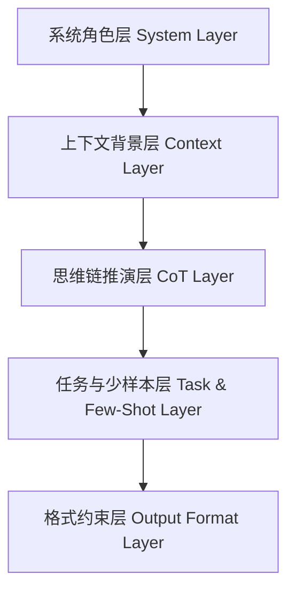
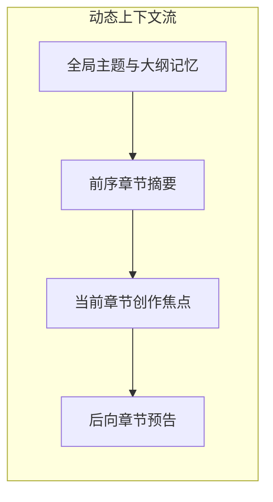

# 提示词工程与上下文管理设计规范 (Prompt & Context Engineering Guide)

---

## 1. 概述与核心目标

在构建**AI智能写作助手**的过程中，大语言模型（LLM）的输出质量与实用性并不单纯取决于模型参数量，而极度依赖于**提示词工程 (Prompt Engineering)** 和 **上下文管理 (Context Management)** 的系统化设计。

本规范确立了从“灵感启发 → 结构化大纲生成 → 逐章节深入扩写 → 语法与风格润色 → 最终成果汇编”的全流程方法论，指导系统自动构建高标准、可读性强、排版优美的 Markdown（.md）文档。

---

## 2. 提示词工程（Prompt Engineering）体系架构

系统采用 **CRISPE + Few-Shot + Chain-of-Thought (CoT)** 复合提示词框架，将指令分为四个核心层次：



### 2.1 系统角色层 (System Role Definition)
系统针对不同文体，预设了专家级的人格画像与认知框架：
- **学术研究专家**：恪守逻辑严谨性、论证客观性与学术范式，避免主观臆断，规范引用与推导。
- **公文与政企写作专家**：行文严谨庄重，格式规范，用词准确凝练，层级分明，讲求政策导向与实操落地。
- **自媒体与营销策划专家**：擅长抓住受众痛点，运用黄金开篇（Hook）、情绪共鸣与号召性行动（CTA），节奏明快。
- **技术文档架构师**：追求概念清晰、步骤分明、代码规范，图表清晰（Mermaid）、边界条件与最佳实践完备。
- **创意文学创作者**：注重人物塑造、场景描摹、情节冲突、感官细节与意境烘托。

### 2.2 思维链 (Chain-of-Thought, CoT) 引导机制
为了避免大模型直接跳入细节导致长文逻辑松散，在生成篇章前必须经历 CoT 思考过程：
1. **意图解析与受众分析**：厘清读者是谁、读者预期的核心收获是什么。
2. **核心论点/主线确立**：提炼文档的核心命题与精神内核。
3. **结构化大纲拆解**：按照“起承转合”或“现状-问题-分析-方案-成效”多层递进划分章节。
4. **逐节写作与承上启下**：明确本章承接何种上文、引出何种下文。

### 2.3 少样本提示 (Few-Shot Exemplars)
通过向模型展示符合黄金标准的优秀范例片段（例如标准学术小结写法、公文通知行文模板），使模型在语法结构、修辞风格、段落长度上保持高度一致性。

### 2.4 Markdown 格式强约束 (Output Formatting)
所有生成内容必须严格遵循标准 CommonMark 规范，包括：
- 严格遵循 `#` 到 `####` 的四级标题阶梯，禁止跳级。
- 重点信息使用引用块 `> [!NOTE]` 或强调加粗 `**`。
- 数据与对比场景必须使用标准 Markdown 表格 `| 表头 |`。
- 技术逻辑与流程必须使用 Mermaid 流程图或时序图。
- 数学公式统一使用 LaTeX 语法（行内 `$E=mc^2$`，行间 `$$...$$`）。

---

## 3. 上下文管理 (Context Management) 机制

在长篇写作中，“上下文漂移”、“前后矛盾”、“遗忘设定”是传统问答式 AI 的核心痛点。本系统通过三层上下文机制解决上述问题：



### 3.1 分层上下文状态机
1. **全局静态上下文 (Global Static Context)**：
   - 全文标题、文体风格、核心主旨、目标字数、受众定位。
   - 保持在每一个生成轮次的 System/Context 头部，确保长文不跑偏。
2. **结构大纲上下文 (Outline State Context)**：
   - 存储已被用户确认或微调的全文目录树。
   - AI 在写第 $N$ 章节时，明确知道当前位于总纲的哪一个分支节点。
3. **滑动记忆与前序摘要 (Sliding Window & Chapter Summary)**：
   - 写作第 $N$ 章时，系统自动提取第 $N-1$ 章的“核心结论与尾部过渡句”，作为输入 Prompt，实现章节无缝衔接。
   - 限制历史对话轮数，防止 Token 溢出与无用噪音干扰。

---

## 4. 典型核心提示词模版定义

### 4.1 大纲生成提示词模版 (Outline Generation)
```markdown
你是一位顶级的写作架构专家。请根据用户提供的主题、目标受众和风格要求，运用思维链（CoT）设计一份结构完整、逻辑层层递进的 Markdown 格式大纲。

【用户输入】
- 写作主题：{topic}
- 目标文体：{genre}
- 核心受众：{audience}
- 预期字数：{target_length}

【设计要求】
1. 包含 3-6 个一级章节，每个一级章节下拆解 2-4 个具体的二级小节。
2. 每一个章节附带简短的写作要点说明（1-2句）。
3. 逻辑符合该文体的经典范式。
4. 输出格式必须为纯 Markdown 列表，方便用户直接审查与调整。
```

### 4.2 章节扩写提示词模版 (Chapter Expansion)
```markdown
你是一位精通 {genre} 的写作专家。现需为你撰写整篇长文中的特定章节。

【全文全局信息】
- 文档总标题：{doc_title}
- 全文核心主旨：{doc_summary}
- 整体行文风格：{tone_and_style}

【承前启后上下文】
- 上一章节结尾摘要：{prev_chapter_summary}
- 下一章节规划内容：{next_chapter_goal}

【当前写作任务】
- 当前章节名称：{current_chapter_title}
- 本章核心要点：{chapter_bullet_points}

【输出约束】
1. 直接输出该章节的 Markdown 正文，以 `## {current_chapter_title}` 开头。
2. 论述详实充分，结合论据、案例或结构化列表展开，字数约 {chapter_words} 字。
3. 与前文保持逻辑过渡自然，严禁出现“在本章中我们将讨论”等生硬空话。
```

### 4.3 文本精炼与润色提示词模版 (Polishing & Refining)
```markdown
你是一位资深文字主编与审校专家。请对用户提供的原始草稿进行全方位润色与提升。

【润色模式】：{polish_mode} (学术规范 / 商务严谨 / 错别字与病句校对 / 爆款网感 / 扩充详实 / 精炼提炼)

【原始文本】
"""
{raw_text}
"""

【优化要求】
1. 修正一切语病、错别字及标点符号错误。
2. 提升词汇丰富度与逻辑连贯性，消除重复罗嗦表述。
3. 保持原意不变的前提下显著提升文采与专业度。
4. 提供两部分输出：
   - **优化后文本**（完整 Markdown 格式）
   - **修改要点解析**（说明优化了哪些关键语句及理由）
```

---

## 5. Markdown 成果规范与元数据构建 (Result Standards)

生成的最终 Markdown 文件统一保存在 `result/` 目录下，并必须符合以下标准规范：

1. **Front Matter 头部声明**：
   ```yaml
   ---
   title: "文档标题"
   date: "2026-10-25"
   author: "AI智能写作助手"
   genre: "文体分类"
   tags: [写作助手, Markdown构建, 提示词工程]
   model: "deepseek-chat"
   word_count: 3200
   ---
   ```
2. **规范文件命名法**：
   - `result/YYYYMMDD_主题名称_vX.md`
3. **内容完整性**：
   - 具备完整前言/摘要、各章节正文、结论与展望，支持一键分发与出版级导出。
