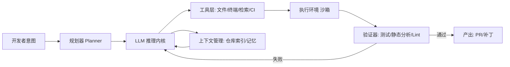

# 大语言模型赋能现代软件工程：从代码生成到自主软件智能体

## 大语言模型赋能现代软件工程：从代码生成到自主软件智能体

软件工程的每一次范式迁移，本质上都是**抽象层级的上移**：从机器指令到汇编、从过程式到面向对象、从单体到云原生。大语言模型（LLM）带来的并非又一次框架更替，而是一次**推理内核的外置**——开发者第一次可以将“意图到实现”的映射过程部分委托给一个具备通用推理能力的系统。这一变化的工程意义，远大于“AI 能补全代码”这一表象。

### 能力分层：一个可落地的认知模型

要避免把 LLM 当作万能黑盒，必须先建立分层视角。本书主张将 LLM 赋能体系拆解为四层，**层与层之间是能力递进而非替代关系**：

| 层级 | 核心能力 | 典型形态 | 控制权归属 |
| :--- | :--- | :--- | :--- |
| L1 生成层 | 代码补全、单函数生成 | IDE Copilot | 人主导，模型建议 |
| L2 交互层 | 多轮对话式重构、解释 | Chat 式开发助手 | 人主导，模型执行 |
| L3 编排层 | 工具调用、多步任务分解 | 工作流 Agent | 人设定目标，系统编排 |
| L4 自主层 | 目标驱动、自我验证与修正 | 自主软件智能体 | 系统主导，人设护栏 |

这条演进主线可以概括为一句话：**控制权从人向系统逐步让渡，而每一次让渡都必须以可验证性作为交换代价**。L1 的补全若出错，人眼即时可辨；而 L4 的智能体若在无人值守下修改了构建脚本，其风险量级截然不同。因此，能力越往上，**工程护栏的密度必须越高**，而非越低。

### 从单点落地到系统跃迁

L1/L2 的落地相对直接：以检索增强（RAG）注入仓库上下文、以静态分析做后置校验、以测试用例作为生成质量的客观标尺。真正的跃迁发生在 L3——当模型开始**调用工具**（读写文件、执行命令、查询文档），架构拓扑随之改变：

该拓扑的关键不在模型本身，而在**验证器闭环**与**沙箱执行环境**——它们决定了系统能否在无人监督下安全试错。缺少 V 与 E，L3 便退化为“会调用工具的聊天框”，不具备工程可信度。

### 工程护栏：可信性的三条底线

无论演进到哪一层，以下约束不可妥协：

- **可观测性**：每一次模型决策（规划步骤、工具调用参数、上下文快照）必须留痕，支持事后审计与回放。
- **最小权限**：工具层按任务授予细粒度权限，默认拒绝写操作与网络访问，沙箱隔离执行。
- **可回滚性**：所有产出以补丁/PR 形式落地，经人工或自动化门禁后方可合入主干。

> 一个反直觉的结论是：**LLM 越强，护栏越不能省**。模型的自主性放大了单次错误的传播半径，护栏不是对模型能力的不信任，而是对系统复杂度的工程敬畏。

### 本章定位与后续铺垫

本章确立了全书的分析框架：**以模型为推理内核、以工具与上下文为外设、以工程约束为护栏的分层能力体系**。后续章节将沿此主线逐层展开——下一章将深入 L1/L2 的代码生成工程化实践，剖析上下文构建、生成质量评估与 IDE 集成的具体方案，为理解更高层的智能体架构奠定基础。

---

## 大语言模型赋能现代软件工程：从代码生成到自主软件智能体

承接前章“推理内核外置”的判断，本章需要回答一个更工程化的问题：**这种外置能力应如何被组织、约束与逐级放大**。答案并非“让模型做更多事”，而是构建一条从**被动生成**到**主动决策**的能力阶梯，每一级都以明确的工程约束为护栏。

### 从补全到自主：四级能力阶梯

| 层级 | 能力形态 | 典型交互 | 关键工程约束 |
|------|----------|----------|--------------|
| L1 | 代码补全 | 行内建议 | 低延迟、上下文窗口裁剪 |
| L2 | 函数/模块生成 | 指令式生成 | 规格明确性、单测校验 |
| L3 | 任务级编排 | 多步工具调用 | 状态管理、失败回滚 |
| L4 | 自主智能体 | 目标驱动闭环 | 沙箱隔离、权限最小化 |

层级跃迁的本质，是**决策权从开发者向系统转移**。L1/L2 中，人仍是唯一决策者，模型仅提供候选；到 L3，模型开始规划步骤并调用工具；至 L4，模型在给定目标与约束下自主迭代，人退居监督位。

### 案例对比：同一需求的两种实现路径

以“为订单服务增加幂等接口”为例：

- **L2 路径**：开发者编写接口签名与注释，模型生成方法体，人工评审后合入。模型不感知项目外的约束。
- **L4 路径**：智能体读取需求单，检索现有幂等组件，生成实现与测试，在沙箱中运行测试套件，失败则自行修正，最终提交 PR 并附变更说明。开发者仅做最终审批。

两者代码产出可能相近，但**工程风险分布截然不同**：后者将“验证”也委托给了模型，因此沙箱、测试覆盖与审批门禁成为不可省略的基础设施。

> **核心论点**：能力层级的提升不降低工程严谨性要求，反而将约束从“代码正确性”上移至“过程可控性”。缺少护栏的自主性，只是把缺陷的产生速度放大了。

### 过渡：分层模型的形式化

上述阶梯需被形式化为可度量、可组合的模型，才能指导工具选型与流程设计。下一章《问题重定义——LLM 在软件工程中的能力分层模型》将给出各层的输入输出契约、评估指标与失效模式，为后续逐层展开的工程实践奠定共同语言。